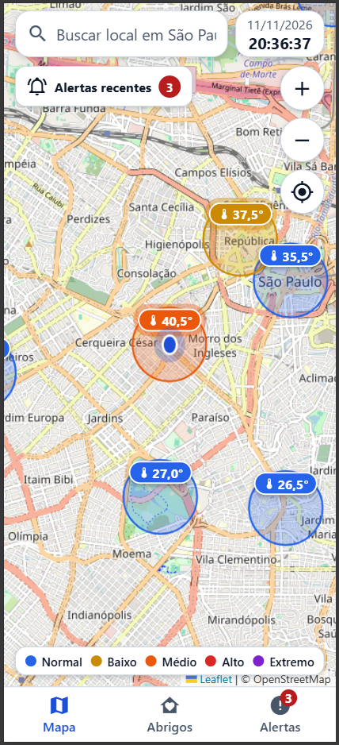
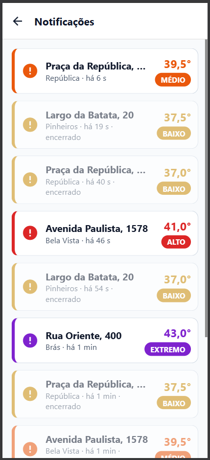
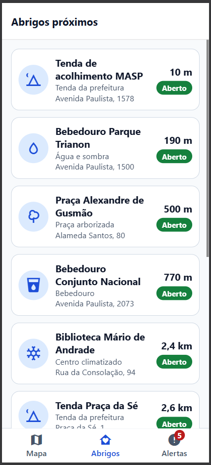
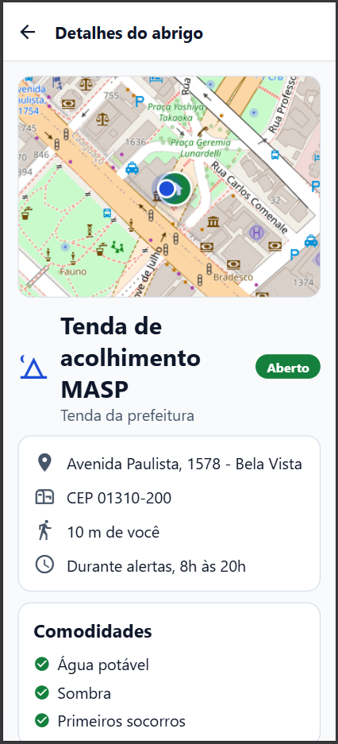
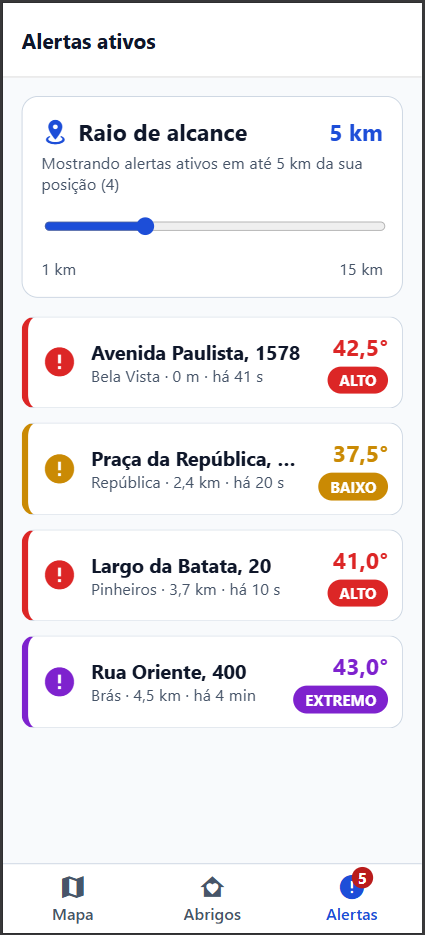
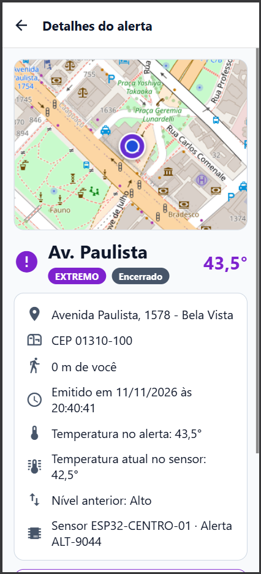

# Refresca SP

O **Refresca SP** é uma iniciativa de CitizenTech desenvolvida para mitigar os impactos das ondas de calor extremo nas grandes cidades. Focando no bem-estar de populações vulneráveis — como trabalhadores ambulantes, pessoas em situação de rua e idosos —, a solução disponibiliza informações em tempo real sobre temperaturas críticas e mapeia pontos de apoio e refúgio urbano (como praças arborizadas, tendas de acolhimento e bebedouros públicos).

### Papel deste aplicativo no projeto

Este aplicativo atua como a interface do cidadão e consome um servidor local de dados em JSON (sensores IoT, pontos de refúgio, locais de busca e localização do usuário):

- **Visualização geográfica em tempo real:** Mapa interativo estilo Google Maps com posicionamento do cidadão (Avenida Paulista) e estações sensoras (ESP32) distribuídas por regiões estratégicas de São Paulo.
- **Navegação em abas (tabs):** Acesso rápido às telas de **Mapa**, **Abrigos** e **Alertas ativos**, além da tela de **Notificações** (histórico paginado de alertas recentes) e das páginas de **detalhes do alerta** e **detalhes do abrigo**.
- **Lista de alertas com filtro de raio:** Permite filtrar os alertas ativos por distância em relação ao usuário (de 1 km a 15 km) com paginação.
- **Simulação climática autônoma:** Ciclo de variação térmica a cada 5 segundos com inicialização defasada (staggered) por sensor.
- **Emissão de alertas escalonados:** 4 níveis de risco térmico (`LOW`, `MEDIUM`, `HIGH`, `EXTREME`), cada um com cor e recomendações oficiais de proteção.
- **Trava de estabilidade para demonstração:** Ao emitir um novo alerta ou transicionar de nível, o sensor mantém a temperatura fixa por 3 ciclos (15 segundos) para visualização e avaliação facilitada.
- **Detecção de proximidade e busca de abrigos:** Quando o cidadão está na região de um alerta ativo, o sistema disponibiliza o botão "Buscar abrigo", direcionando para a listagem ordenada de pontos de hidratação e áreas sombreadas.
- **Servidor de dados e tratamento de erros:** Os dados iniciais são servidos por um servidor HTTP em Node.js (`server/server.js`) na porta `3001`, iniciado automaticamente junto com o app, e o aplicativo trata cenários de indisponibilidade, timeout e erro com opção de nova tentativa.

## Pré-requisitos

- **Node.js:** Versão 20 ou superior instalada.
- **npm:** Gerenciador de pacotes padrão do Node.

## Como rodar o projeto

1. Instale as dependências do projeto:

```bash
npm i
```

2. Inicie a aplicação web. O script `scripts/dev.js` sobe o servidor de dados na porta `3001`, aguarda o `/health` responder e só então inicia o Metro Bundler. Ao encerrar o app (`Ctrl+C`), o servidor também é encerrado:

```bash
npm run web
```

3. Após a inicialização do Metro Bundler, acesse no navegador:

```text
http://localhost:8081
```

## Integrantes

| Nome | RM |
| --- | --- |
| Gustavo Atanazio | 559098 |
| Matheus Vinícius | 555177 |
| Nicolas Borges | 556617 |
| Gustavo Coelho | 556289 |
| Igor Ribeiro | 556010 |

## Ficha da CitizenTech

| Requisito | Valor |
| --- | --- |
| Nome da CitizenTech | Refresca SP |
| Cidade e bairro | São Paulo, SP |
| Cidadão beneficiado | Todos |
| Problema, em uma frase | Ondas de calor pela cidade |
| Como funciona | Sensores IoT espalhados pela cidade monitoram a temperatura em tempo real; quando o calor atinge níveis críticos, o sistema emite alertas escalonados por risco e direciona o cidadão pelo aplicativo para os pontos de refúgio mais próximos (bebedouros públicos, áreas sombreadas e tendas de acolhimento). |
| O que cada parte faz | **Sensor IoT (ESP32 + DHT22):** coleta leituras de temperatura; **Modelo de ML (Python):** prevê tendências de ondas de calor; **API SOA:** processa as leituras e gerencia alertas por nível de risco; **API C# (.NET):** gerencia o cadastro de pontos de refúgio e hidratação; **App Mobile/Web (React Native + Expo):** interface do cidadão com mapa interativo, notificações de alerta e busca de abrigos próximos; **Infra, Segurança e QA:** scripts de automação/monitoramento em Linux, detecção de vazamento de dados sensíveis em logs e plano de testes. |
| Link do repositório | [https://github.com/gustavo-atanazio/refresca-sp](https://github.com/gustavo-atanazio/refresca-sp) |
| Indicador de impacto | Quantidade de cidadãos alertados em regiões de calor extremo, número de encaminhamentos para pontos de hidratação/sombra e redução de ocorrências de insolação e desidratação na população vulnerável. |
| ODS conectados | **ODS 3** (Saúde e Bem-Estar), **ODS 11** (Cidades e Comunidades Sustentáveis) e **ODS 13** (Ação Contra a Mudança Global do Clima). |

## Capturas de tela do aplicativo

### Tela do mapa


### Tela de notificações


### Tela de abrigos


### Tela de abrigo


### Tela de alertas


### Tela de alerta


### Comandos úteis do servidor de dados

Caso queira executar apenas o servidor de dados:

```bash
# Subir somente o servidor de dados
npm run server

# Verificar o status da API
curl http://localhost:3001/health
```

| Endpoint | Descrição |
| --- | --- |
| `GET /health` | Status do servidor (`{ "status": "ok" }`) |
| `GET /sensors` | Lista de sensores IoT iniciais |
| `GET /refuges` | Lista de pontos de refúgio e hidratação (Contrato 3) |
| `GET /places` | Locais pesquisáveis na barra de busca |
| `GET /user-location` | Coordenadas, endereço e raio de afetação do cidadão |

> **Dica para teste mobile:** Abra as ferramentas de desenvolvedor do navegador (F12) e ative a barra de emulação de dispositivos móveis para conferir a interface responsiva. Para testar pelo aplicativo **Expo Go** no celular, certifique-se de que o computador e o celular estão na mesma rede Wi-Fi e que a porta `3001` está liberada no firewall (ou defina `EXPO_PUBLIC_API_URL=http://<IP_DO_PC>:3001`).